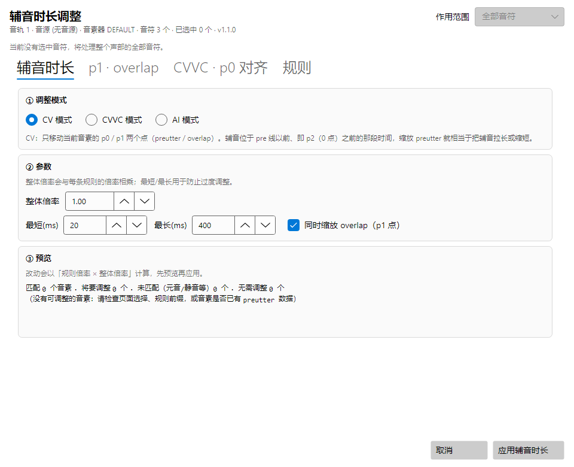
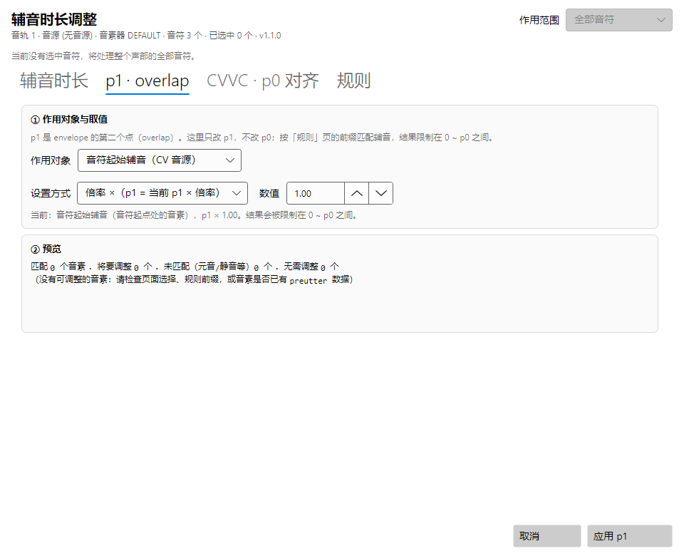
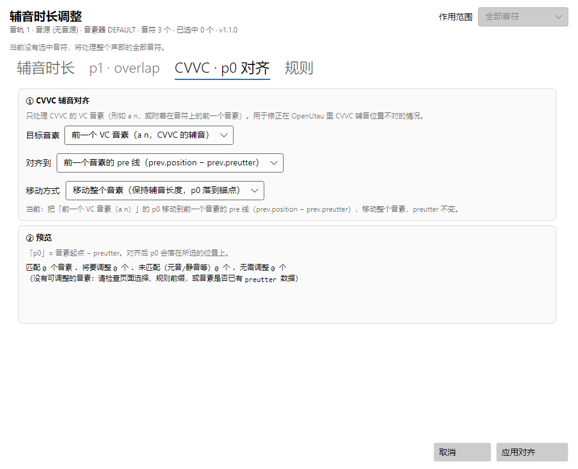
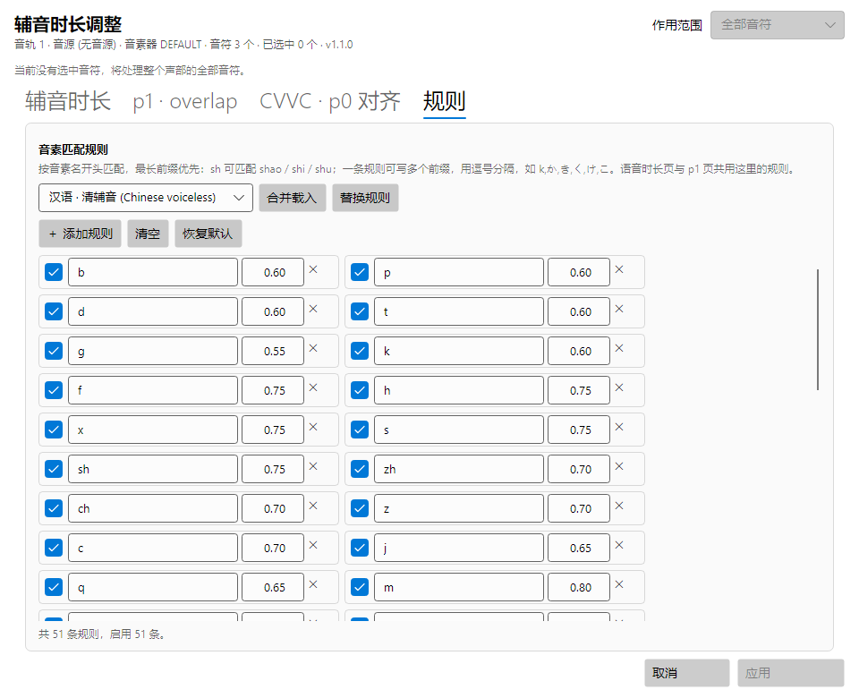
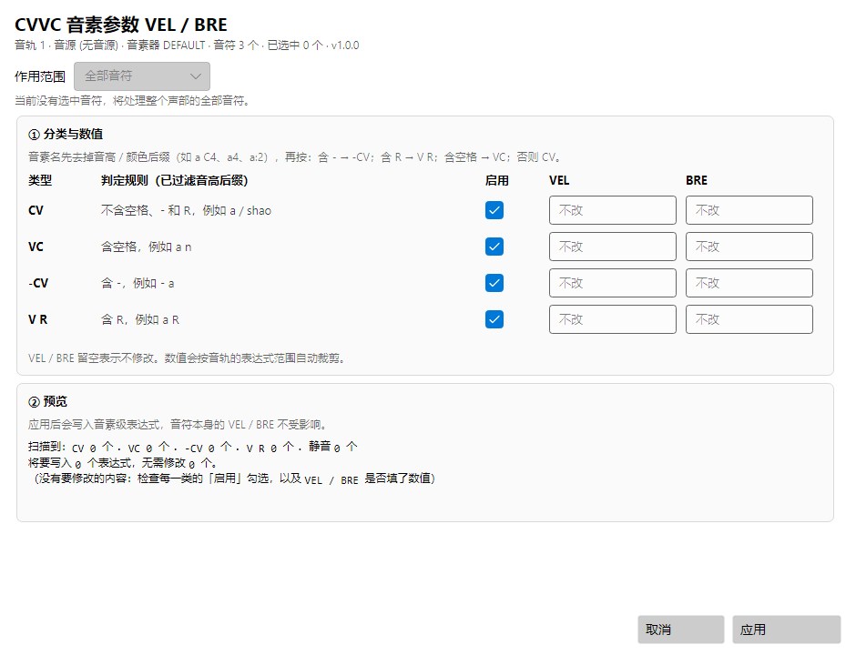

# OpenUtau 插件合集

两个 OpenUtau 外置插件，都在钢琴卷帘里通过 **External（外部插件）** 菜单打开：

| 插件 | DLL | 作用 |
| --- | --- | --- |
| **辅音时长调整**<br>Consonant Length Adjuster | `OpenUtau.Plugin.ConsonantLength.dll` | 批量调整辅音长度（CV / CVVC / AI）、单独调整 p1（overlap）、把 CVVC 辅音的 p0 对齐到指定位置 |
| **CVVC 音素参数**<br>CVVC Expression Editor | `OpenUtau.Plugin.CVVCExpression.dll` | 按 CV / VC / -CV / V R 分类批量写入音素级 **VEL** 与 **BRE** |

两个 DLL 相互独立，可以只装其中一个。

## 界面预览

| 辅音时长 | p1 / overlap |
| --- | --- |
|  |  |

| CVVC · p0 对齐 | 规则 |
| --- | --- |
|  |  |



> 截图由 `tests/UiLayoutProbe`（无头 Avalonia）生成，颜色会随 OpenUtau 主题变化。

---

## 安装

1. 到 [Releases](../../releases) 下载 `OpenUtau-Plugins-<版本>.zip`。
2. 解压出两个 DLL（或你需要的那个）。
3. 放进 OpenUtau 的 **Plugins** 文件夹：

   | 版本类型 | Plugins 目录 |
   | --- | --- |
   | 便携版 / 开发版（程序目录下没有 `installed.txt`） | `<OpenUtau 程序目录>\Plugins\` |
   | 安装版（有 `installed.txt`） | `文档\OpenUtau\Plugins\`（`%USERPROFILE%\Documents\OpenUtau\Plugins`） |
   | macOS | `~/Library/OpenUtau/Plugins/` |
   | Linux | `~/.local/share/OpenUtau/Plugins/` |

   > 也可以放进 Plugins 下的子文件夹，例如 `Plugins\ConsonantLength\`。
4. 重启 OpenUtau。

配置分别保存在 `Plugins\ConsonantLength\settings.json` 与 `Plugins\CVVCExpression\settings.json`。

**卸载**：删除对应 DLL 与配置文件目录即可。

---

# 插件一：辅音时长调整

钢琴卷帘 → 选中音符（不选则处理整个声部）→ 右键 → **External** → **辅音时长调整 (Consonant Length)**。

窗口有 4 个页面：**辅音时长**、**p1 · overlap**、**CVVC · p0 对齐**、**规则**。前三页各自有独立预览，点右下角按钮应用当前页面的改动；「规则」页是前两页共用的匹配规则。

所有改动都会进入同一个 Undo 组，一次 Ctrl+Z 即可整体还原。

## 页面 1：辅音时长（三种模式）

| 模式 | 操作 | 适用 |
| --- | --- | --- |
| **CV** | 只移动当前音素的 **p0 / p1**（`preutter` / `overlap`） | 普通 CV 音源：一个音符一个发音，辅音在 pre 线以前、p2 之前的区域 |
| **CVVC** | 移动**前一个音素**（VC，例如 `a n`）的 pre 线 / 起点 | CVVC 音源：辅音位于 VC 采样尾部 |
| **AI** | 按音素名匹配（`sh` `ao` `ch` `e`），直接移动辅音音素的起点改变长度（终点不变） | DiffSinger / ENUNU / VOGEN 等 AI 音源 |

```
CV 模式：
                 p0        p1              p2
   ──────────────●─────────●───────────────●──────────────
                  \        /               /
     (辅音段)      \______/  ← 这段被缩放  → 元音从 p2 开始

CVVC 模式：
   音符1: a           音符2: a
   [ CV a ]  [ VC a n ] [ CV a ]
              ↑ 移动这个音素（VC）的 pre 线 / 起点
```

- **整体倍率**：与每条规则的倍率相乘，默认 1.00。
- **最短 / 最长 (ms)**：结果保护范围。
- **同时缩放 overlap**：CV 模式下 p1 是否跟随 p0 一起缩放。

## 页面 2：p1 · overlap（单独调整）

只改 envelope 的第二个点 p1（`overlap`），不动 p0：

| 设置方式 | 说明 |
| --- | --- |
| **倍率 ×** | `p1 = 当前 p1 × 倍率` |
| **绝对值** | `p1 = 指定 ms` |
| **占 p0 的比例** | `p1 = p0 × 比例`，例如 0.3 表示 p1 占整个辅音长度的 30% |

作用对象分三种：音符起始辅音（CV）、前一个 VC 音素（CVVC）、全部匹配音素（AI）。结果自动限制在 `0 ~ p0` 之间。

## 页面 3：CVVC · p0 对齐

用于修正 OpenUtau 里 CVVC 辅音音素位置不对的问题：把某个音素的 **p0**（起点 − preutter）批量移动到指定锚点。

| 选项 | 取值 |
| --- | --- |
| 目标音素 | 前一个 VC 音素（`a n`）/ 当前音符的起始辅音（CV） |
| 对齐到 | 前一个音素的 **pre 线**（`prev.position − prev.preutter`）/ 前一个音素的**位置线**（`prev.position`）/ 前一个音素的**终点**（`prev.End`） |
| 移动方式 | 移动整个音素（保持辅音长度）/ 只移动 p0（改变 preutter，音素位置不变） |

> 锚点落在前一个音素内部时，OpenUtau 不允许音素重叠成负时长，结果会被限制在 `prev.position + 10 tick`，预览里会出现提示。想让 VC 正好接在前一个音素后面，请选「前一个音素的终点」。

## 页面 4：规则

规则 = **前缀 + 倍率**。匹配时对音素名（以及它映射到的 oto 别名）做开头匹配，多条命中取**最长前缀**。

| 写法 | 含义 |
| --- | --- |
| `sh` | 匹配 `shao` / `shi` / `shu` / `sha` … |
| `b` | 匹配 `ba` / `bo` / `bi` … |
| `k,か,き,く,け,こ` | 一条规则写多个前缀，用逗号分隔（假名别名也能匹配） |
| `a n` 中的 `n` | VC 别名按空格 / 连字符拆分，取辅音那一侧再匹配 |

内置预设（「合并载入」或「替换规则」）：

- **汉语 · 清辅音**：b p d t g k f h j q x zh ch sh z c s
- **汉语 · 浊辅音**：m n ng l r y w
- **日语 · 清辅音**：k s t h p ch ts sh f（含 か行/さ行/た行/は行/ぱ行/っ 假名）
- **日语 · 浊辅音**：g z j d b（含 が行/ざ行/だ行/ば行/ま行/な行/ら行/や行/わ行 假名）

可以随时添加 / 删除 / 停用规则，例如 `b,g = 0.5`、`sh,ch = 0.7`。

---

# 插件二：CVVC 音素参数（VEL / BRE）

钢琴卷帘 → 右键 → **External** → **CVVC 音素参数 VEL/BRE (CVVC Expression)**。

按音素名自动分类，批量写入音素级 `VEL` 与 `BRE`：

| 类型 | 判定（**先过滤音高 / 颜色后缀**） | 例子 |
| --- | --- | --- |
| **CV** | 不含 `-`、不含 `R`、不含空格 | `a`、`shao` |
| **VC** | 含空格 | `a n` |
| **-CV** | 含 `-` | `- a` |
| **V R** | 含 `R`（大写） | `a R` |
| 静音 | `R` / `-` / `sil` / `pau` / `br` / `cl` 等 | 不处理 |

**音高后缀过滤**：音素名会先去掉颜色后缀（`a:2`）与音高后缀（`a C4`、`a#4`、`a4`、`a_C4`），所以 `a C4` 仍然是 **CV**，不会被空格误判成 VC；`a n C4` 仍然是 **VC**。

界面上每一类都有：启用勾选、VEL 输入框、BRE 输入框；**留空 = 不修改**。数值会按音轨的表达式范围自动裁剪，并写入音素级表达式（不改音符本身的 VEL / BRE）。

---

## 常见问题

**Q：点应用后没有变化？**
A：看预览区的统计。
- 「未匹配」很多：检查规则前缀（假名音源要写假名）。
- 「无需调整」很多：CV 模式下音素 `preutter` 为 0（AI 音源、纯元音、静音）——请改用 AI 模式；或倍率 = 1.00。
- 「N 个音符还没有音素」：声部还没音素化（等音源加载完成 / 切换音素器）。

**Q：可以连续应用两次吗？**
A：可以，但倍率是**相对当前值**的。建议一次调到位，或先 Ctrl+Z。

**Q：会改动音符时值 / 节奏吗？**
A：不会。插件只改音素的时间参数与表达式，音符的 position / duration 不变。

**Q：支持官方 OpenUtau 吗？**
A：支持。插件只使用公开的 `BatchEdit` 接口与音素时间命令（`PhonemePreutterCommand` / `PhonemeOverlapCommand` / `PhonemeOffsetCommand` / `SetPhonemeExpressionCommand`）。发布包用 .NET 8 编译，可在 .NET 8 及以上（含 .NET 10）的 OpenUtau 中加载。

**Q：和「辅音时长」页的 CV 模式有什么区别？**
A：CV 模式同时缩放 p0 和 p1；「p1」页只动 p1，不影响辅音长度。

---

## 从源码构建

需要 .NET 8 SDK。

```powershell
# 方式一：指向已安装的 OpenUtau 里的 OpenUtau.Core.dll
$env:OPENUTAU_CORE_PATH = "C:\Program Files\OpenUtau\OpenUtau.Core.dll"
dotnet build src\OpenUtau.Plugin.ConsonantLength -c Release
dotnet build src\OpenUtau.Plugin.CVVCExpression -c Release

# 方式二：把 OpenUtau.Core.dll 放到 lib\ 下，构建时会自动使用

# 一键构建 + 测试 + 打包
powershell -ExecutionPolicy Bypass -File .\pack.ps1
```

测试：

```powershell
dotnet run --project tests\ConsonantLength.Tests      # 辅音时长 / p1 / 对齐逻辑
dotnet run --project tests\ExpressionEditor.Tests      # 音素分类 / VEL/BRE 规划
dotnet run --project tests\PluginLoadProbe -- <OpenUtau.Core.dll> <plugin.dll>

# 界面截图工具（开发用，需要 OpenUtau.Core.dll）：把两个窗口渲染成 PNG 到 bin/.../shots/
dotnet run --project tests\UiLayoutProbe
```

> 插件只引用编译期的 `OpenUtau.Core.dll` 与 `Avalonia`（运行时使用 OpenUtau 自带的 Avalonia），所以发布包里只有两个 DLL。

---

## 目录结构

```
src/OpenUtau.Plugin.ConsonantLength/     插件一
  ConsonantLengthAdjuster.cs             BatchEdit 入口
  ConsonantLengthWindow.cs               Avalonia 窗口（4 个页面）
  VoicePartAdapter.cs                    文档对象 <-> 纯规划逻辑
  Model/ConsonantRule.cs                 规则 / 设置模型
  Model/ConsonantPresets.cs              汉语 / 日语 清浊预设
  Model/PhonemeMatcher.cs                音素名前缀匹配
  Model/ConsonantPlanner.cs              CV / CVVC / AI / p1 / 对齐 的纯逻辑
  Model/PluginSettingsStore.cs           配置读写与日志
src/OpenUtau.Plugin.CVVCExpression/      插件二
  CvvcExpressionAdjuster.cs              BatchEdit 入口
  ExpressionWindow.cs                    Avalonia 窗口
  ExpressionAdapter.cs                   文档对象 <-> 纯规划逻辑
  Model/PhonemeName.cs                   音高后缀过滤 + CV/VC/-CV/V R 分类
  Model/ExpressionSettings.cs            分类配置模型
  Model/ExpressionPlanner.cs             VEL / BRE 规划
  Model/PluginStore.cs                   配置读写与日志
tests/ConsonantLength.Tests/             插件一测试（不依赖 OpenUtau）
tests/ExpressionEditor.Tests/            插件二测试（不依赖 OpenUtau）
tests/PluginLoadProbe/                   模拟 DocManager 的插件加载探测
```

## 更新日志

### 1.1.1
- 修复界面：输入框加宽（数值不再被上下箭头挤掉）、字号加大；CVVC 参数页的分类表格改为真正的多行布局，不再重叠；规则页规则列表填满窗口高度。

### 1.1.0
- 新增「p1 · overlap」页：按倍率 / 绝对值 / 占 p0 比例单独调整 p1。
- 新增「CVVC · p0 对齐」页：把辅音 p0 批量对齐到前一个音素的 pre 线 / 位置线 / 终点。
- 新增第二个插件：CVVC 音素参数 VEL / BRE（含音高后缀过滤）。

### 1.0.0
- 首个版本：CV / CVVC / AI 三种模式，汉语/日语清浊预设，自定义规则，实时预览。

## 许可证

[MIT](LICENSE)

---

## English summary

Two independent OpenUtau external plugins (drop the DLLs into the OpenUtau `Plugins` folder, restart, then right click notes → **External**).

**1. Consonant Length Adjuster** (`OpenUtau.Plugin.ConsonantLength.dll`)
- Duration page: CV mode scales `preutter`/`overlap` (p0/p1); CVVC mode moves the VC phoneme's pre line; AI mode matches phonemes by name (`sh`, `ao`, …) and moves their start.
- p1 page: set overlap by ratio, absolute ms, or as a fraction of `preutter`.
- CVVC p0 alignment page: move a consonant's p0 onto the previous phoneme's pre line, position, or end.
- Shared prefix rules with Mandarin/Japanese voiceless & voiced presets, longest-prefix matching, live preview, single undo step.

**2. CVVC Expression Editor** (`OpenUtau.Plugin.CVVCExpression.dll`)
- Classifies phonemes as CV / VC / -CV / V R after stripping pitch and color suffixes (`a C4`, `a#4`, `a4`, `a:2`).
- Writes phoneme level VEL and BRE per category; empty fields are left untouched; values are clamped to the track's expression range.

Build with .NET 8 SDK against `OpenUtau.Core.dll` (`OPENUTAU_CORE_PATH`), or run `pack.ps1`.